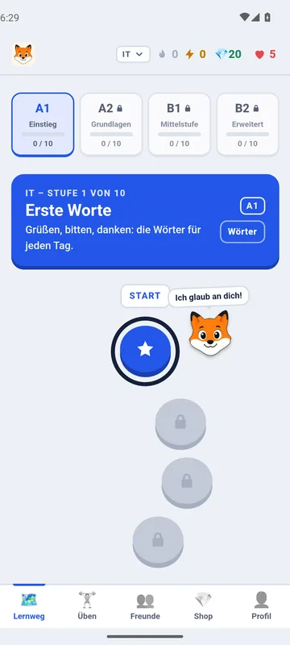
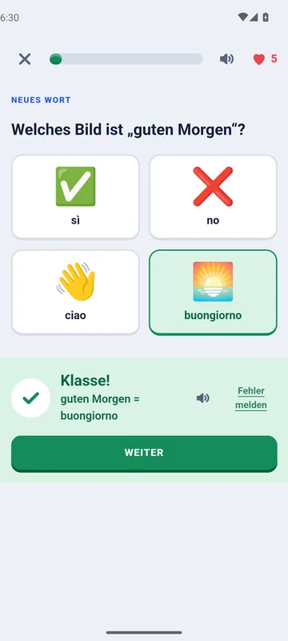
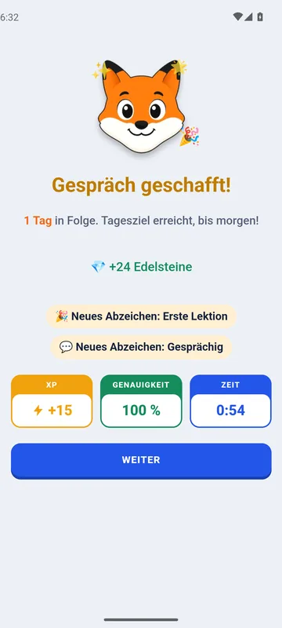
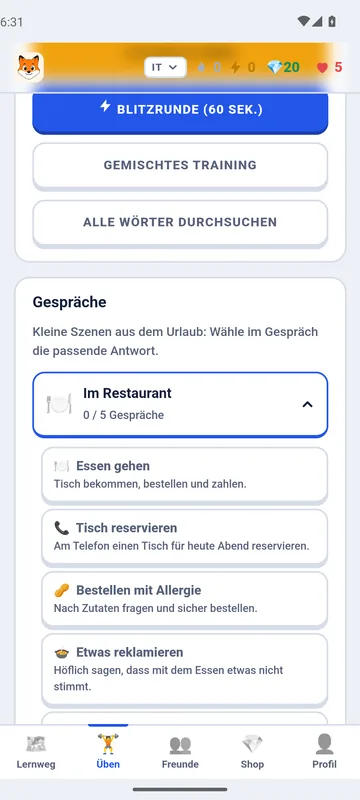
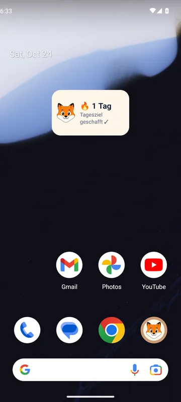
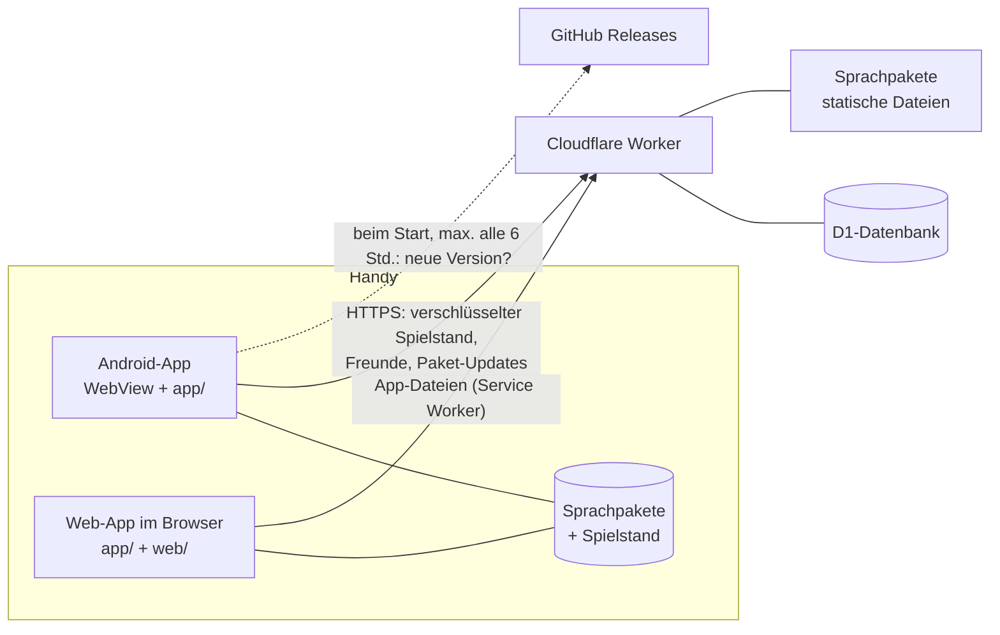

<p align="center"></p>

# OpenSprachFuchs

Eine freie Sprachlern-App für Android und den Browser (auch iPhone und iPad), inspiriert von Duolingo: ohne Werbung, ohne Tracking, ohne Abo. Gemacht für Deutschsprachige, die für Alltag und Urlaub **Englisch, Französisch, Spanisch, Italienisch, brasilianisches Portugiesisch oder Kroatisch** lernen wollen.

OpenSprachFuchs ist ein unabhängiges Open-Source-Projekt und hat nichts mit Duolingo zu tun.

> ⚠️ **Experimentell:** OpenSprachFuchs ist in einer frühen Version (0.x). Funktionen, Datenformat und Backend können sich noch ändern, und es kann Fehler geben. Wichtige Lernfortschritte bitte nicht allein darauf verlassen.

## Screenshots

| Lernweg mit Stufen | Lektion | Gespräch |
|:---:|:---:|:---:|
|  |  |  |
| **Geschafft!** | **Üben & Gespräche** | **Widget** |
|  |  |  |

## Funktionen

- **Lernweg** mit 80 Einheiten (380 Lektionen) pro Sprache: je 20 Einheiten in den Stufen A1, A2, B1 und B2 (in A1 je 7 Lektionen, sonst 4), wählbar über Reiter, dazu ein Einstufungstest zum Überspringen
- **Übungen:**
  - Bilder und Paare zuordnen
  - Sätze aus Wortkarten bauen
  - Lückentext, Hören und selbst tippen
  - Nachsprechen über die Spracherkennung des Handys
  - Mini-Gespräche
- **Sonderstationen:** nach den Lektionen jeder Stufe ein letzter Knopf mit Extra-XP und Edelsteinen, der die nächste Stufe öffnet. Abwechselnd Wortsuche, Buchstabensalat, Memory und Wortraten mit den Wörtern der Stufe, an jeder fünften Stufe eine Kurzgeschichte zum Lesen und Hören mit Verständnisfragen
- **Lernhilfen:**
  - Wörter in Sätzen antippen zeigt die Übersetzung
  - Wortlisten mit Suche
  - Wiederholung mit Lernstufen (Spaced Repetition)
- **Motivation:**
  - XP, Tagesziel, Serie, Combo-Bonus
  - Blitzrunde, Tagesaufgaben, Abzeichen, Statistik
  - Meisterschaft (Bronze, Silber, Gold)
  - Edelsteine und Shop
- **Freunde:**
  - bis zu 100 Freunde über einen Freundescode
  - eine gemeinsame Serie mit jedem Freund
  - täglich ein kostenloses Geschenk (5 💎)
- **Offline:** Alles außer Sicherung und Freunden funktioniert ohne Internet. Die Sprachpakete stecken in der App und kommen als Update vom Server.
- **Im Browser:** Die Web-App unter [app.opensprachfuchs.workers.dev](https://app.opensprachfuchs.workers.dev/) lässt sich auf den Home-Bildschirm legen (iPhone: Safari → Teilen → „Zum Home-Bildschirm“) und läuft dann auch offline. Erinnerung, Widget und Spracherkennung gibt es nur in der Android-App.
- **Anonymes Konto:**
  - ein zufälliger Schlüssel statt Name, E-Mail oder Passwort
  - der Spielstand wird auf dem Handy verschlüsselt, bevor er gesichert wird
  - Details stehen in [PRIVACY.md](PRIVACY.md)

## Aufbau

| Pfad | Inhalt |
|---|---|
| [`app/`](app) | Die App selbst: HTML, CSS und JavaScript ohne Build-Schritt. Läuft in der Android-WebView und als Web-App im Browser. |
| [`web/`](web) | Nur für die Web-App: Manifest, Icons, Service Worker (Vorlage) |
| [`android/`](android) | Android-Projekt: WebView, Sprachausgabe, Spracherkennung, Erinnerung |
| [`packs/`](packs) | Sprachpakete als JSON, eines pro Sprache ([Format](packs/README.md)) |
| [`worker/`](worker) | Backend für Cloudflare Workers + D1: Konten, verschlüsselte Spielstände, Freunde, Sprachpakete |
| [`tools/`](tools) | `packs.mjs` (Pakete prüfen und bauen), `web.mjs` (Web-App bauen), `release.sh` (Release auf GitHub) |
| [`test/`](test) | Tests für Spiellogik, Backend und Web-App |



## Schnellstart für Entwickler

Voraussetzungen: **Node.js 22.5 oder neuer** und, für die App, **Android Studio** (bringt JDK und Android SDK mit).

```bash
npm test
```

Das prüft die Sprachpakete und lässt beide Tests laufen. Alles läuft lokal, ohne Konto bei Cloudflare.

Die Oberfläche lässt sich auch im Desktop-Browser ansehen, zum Beispiel mit `npx serve app`. Sprachausgabe, Spracherkennung und Erinnerung gibt es dort aber nur eingeschränkt.

## Web-App

Der Worker liefert unter seiner Adresse auch die Web-App aus. `npm run web` (oder `npm run build` in `worker/`) baut sie aus `app/` und `web/` nach `worker/public/`: Dabei bekommt `index.html` Manifest und Icons, und `sw.js` erhält die Liste aller Dateien und eine Version aus deren Prüfsumme. Mit `npm run deploy` in `worker/` ist eine Änderung an `app/` sofort für alle Web-Nutzer live; installierte Web-Apps laden sie beim nächsten Start. Die Android-App bekommt Änderungen weiterhin nur über ein Release.

Im Browser fehlen die Brücke zum Handy und damit Erinnerung, Widget und Spracherkennung; die Sprachausgabe kommt vom Browser. Freundes-Links (`/f#Code/Name`) bieten „Im Browser lernen“ an und öffnen die Web-App mit `/#f/Code/Name`.

## Backend einrichten (Cloudflare, kostenlos)

Der kostenlose Tarif von Cloudflare reicht für ein kleines Projekt: 100.000 API-Anfragen am Tag, 5 GB Datenbank, statische Dateien (die Sprachpakete) ohne Limit.

1. Ein Cloudflare-Konto anlegen und im Ordner `worker/` die Werkzeuge installieren:
   ```bash
   cd worker
   npm install
   npx wrangler login
   ```
2. Die Vorlage für die Konfiguration kopieren. `wrangler.toml` bleibt lokal und kommt nicht in Git.
   ```bash
   cp wrangler.example.toml wrangler.toml
   ```
3. Datenbank anlegen (`weur` = Westeuropa) und die ausgegebene `database_id` in `worker/wrangler.toml` eintragen:
   ```bash
   npx wrangler d1 create opensprachfuchs --location weur
   ```
4. Tabellen anlegen:
   ```bash
   npm run schema
   ```
5. Bauen und veröffentlichen. Das baut auch die Sprachpakete und die Web-App:
   ```bash
   npm run deploy
   ```
   Wrangler zeigt danach die Adresse, z. B. `https://opensprachfuchs.<dein-name>.workers.dev/`.
6. Diese Adresse in [`app/js/config.js`](app/js/config.js) als `BACKEND_URL` eintragen. Dort gehören auch dein GitHub-Repository (`GITHUB_REPO`, für Update-Hinweise) und unter `OPERATOR` Name und Kontakt des Betreibers hin. Letzteres verlangt die DSGVO für den Datenschutzhinweis.

**Fehlermeldungen aus der App** („Fehler melden“) ansehen und als GitHub-Issues anlegen (eines pro Sprache und Einheit, Label „Fehlermeldung“):

```bash
node tools/reports.mjs
```

```bash
node tools/reports.mjs --issues
```

Bestehende Datenbanken brauchen dafür einmal die Migration `worker/migrations/0001_reports_issue.sql`.

**Lokal testen:** `npm run dev` startet den Worker unter `http://localhost:8787`. Wird die App über `localhost` geöffnet, nutzt sie automatisch dieses Backend.

## Android-App bauen

1. In Android Studio *File → Open* wählen und den Ordner `android/` öffnen. Das ganze Repository muss vorhanden sein, denn der Build holt sich `app/` und `packs/` aus dem übergeordneten Ordner. Er braucht dafür Node; liegt es nicht unter `/opt/homebrew/bin` oder `/usr/local/bin`, den Pfad mit `-PnodePath=/pfad/zu/node` angeben.
2. Zum Ausprobieren auf ▶ *Run* klicken, oder im Terminal:
   ```bash
   ./gradlew assembleDebug
   ```
   Die APK liegt danach unter `android/app/build/outputs/apk/debug/`.

### Release bauen und auf GitHub veröffentlichen

Releases müssen immer mit **demselben Schlüssel** signiert sein, sonst lassen sich Updates nicht über die alte Version installieren.

1. Einmalig einen Schlüssel erzeugen. **Datei und Passwörter gut sichern, nie ins Repository!**
   ```bash
   keytool -genkeypair -v -keystore ~/opensprachfuchs-release.jks -keyalg RSA -keysize 4096 -validity 10000 -alias opensprachfuchs
   ```
2. Die Datei `android/keystore.properties` anlegen. Sie steht in `.gitignore`.
   ```properties
   storeFile=/Users/<du>/opensprachfuchs-release.jks
   storePassword=…
   keyAlias=opensprachfuchs
   keyPassword=…
   ```
3. In [`android/app/build.gradle.kts`](android/app/build.gradle.kts) `versionCode` um 1 erhöhen und `versionName` setzen, z. B. `0.0.2`.
4. Bauen und veröffentlichen. Das braucht die [GitHub CLI](https://cli.github.com) und `gh auth login`:
   ```bash
   tools/release.sh
   ```
   Das Skript führt die Tests aus, baut die signierte APK und legt das Release `v<versionName>` mit der APK an. Versionen unter 1.0 werden auf GitHub als Vorabversion („Pre-release“, experimentell) markiert. Die App weist dann auf die neue Version hin.

**Auf dem Handy installieren:** die APK aus den GitHub-Releases herunterladen und öffnen. Beim ersten Mal fragt Android, ob Installationen aus dieser Quelle erlaubt sind.

## Mitmachen

Korrekturen an den Übersetzungen und neue Sprachen sind sehr willkommen. Wie das geht, steht in [CONTRIBUTING.md](CONTRIBUTING.md).

## Lizenz

- Code: [MIT](LICENSE)
- Sprachpakete in `packs/`: [CC BY-SA 4.0](packs/LICENSE)
- Schrift Nunito in `app/fonts/`: [SIL Open Font License 1.1](app/fonts/OFL.txt)
